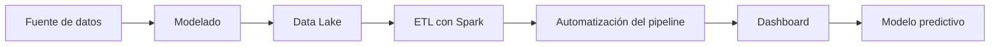

# Proyecto 1 - ITACA

## Descripción y objetivo

El objetivo será construir un **dashboard** (cuadro de mandos) de análisis académico usando **Power BI** a partir de datos *"reales"* en formato **XML** extraídos de la plataforma **ITACA** de la **Consellería de Educación**.

## Arquitectura

Usaremos una arquitectura **Batch**.

Tecnologías usadas:
- MongoDB
- Spark
- Airflow
- Power BI 



## Fuentes de datos

Cuatro tablas exportadas de ITACA como ficheros XML:
- Alumnos
- Contenidos
- Calificaciones
- Cursos

De los cuales consumiremos las siguientes columnas:
| Tabla | Contenido | Campos Clave |
| --- | --- | --- |
| Alumnos | Un registro por alumno y año académico | NIA, sexo, nacionalidad, provincia, municipio, ensenanza, curso, grupo, turno, linea,modalidad, repite, estado_matricula, tipo_matricula, fecha_matricula, fecha_ingreso_centro |
| Contenidos | Módulos que se imparten en cada curso | codigo, nombre_cas, nombre_val, ensenanza, curso |
| Calificaciones | Nota de cada alumno en cada módulo y evaluación | evaluacion, alumno, ensenanza, curso, contenido,bloque_contenido, nota_numerica, tipo_nota |
| Cursos | Catálogo jerarquico de cursos y ciclos formativos | codigo, nombre_cas, nombre_val, abreviatura, ensenanza, padre |


| Fuente | URL / Origen | Formato | Frecuencia actualización | Licencia | Última ingesta |
| --- | --- | --- | --- | --- | --- |
| AULES | ITACA | XML | Única | SIN LICENCIA | 29/10/2026 |

>[!NOTE]
La tabla de arriba no es definitivo, se irá actualizando a medida que avance el proyecto.

## Estructura del repositorio

Estas son las carpetas del repositorio:

| Carpeta | Contenido |
| --- | --- |
| dashboard/ | Vacía de momento |
| etl | Vacía de momento |
| data/curated | Vacía de momento |
| data/processed | Vacía de momento |
| data/raw | Resultados en .json de la ingesta |
| ingesta | Scripts para ingestar |

## Entorno

### Anclar la versión de python del entorno

Usamos pyenv para que siempre use la misma versión:
`pyenv local 3.14.4`

### Crear el entorno

Usaremos un entorno aislado para no tener conflictos con los paquetes.
`python -m venv .venv`

Lo activamos con:
`source .venv/bin/activate`

Lo desactivamos escribiendo `deactivate` en la terminal.

### Requisitos del proyecto

Los requisitos están recogidos en **requirements.txt**. Se instala con:
`pip install -r requirements.txt`

### Como desplegar el entorno

Con el **.env.example** que nos descargaremos, lo copiamos al que utiliza el repositorio y cumplimentamos los datos que sean necesarios.
`cp .env.example .env`

Levantamos los contenedores en modo *detached* con:
`docker compose up -d`

Para mirar que contenedores tenemos:
`docker compose ps`

Para parar el contenedor con:
>[!WARNING]
Perderemos los datos que no estén guardados en volumenes persistidos

`docker compose down`

## Como realizar la ingesta

Para realizar la ingesta, deberás de tener tus datos estructurado en una carpeta general y dentro de ella una/unas carpetas con el curso (por ejemplo 2021-22) y dentro de ella los 4 ficheros xml. Con esta estructura:
```
Carpeta
    2021-22
        alumnos.xml
        ...
    2022-23
        alumnos.xml
        ...
    ...
```

Ejecutas el siguiente comando desde la raíz del proyecto:
`python ingesta/ingesta_itaca_xml.py ruta`
Donde **ruta** es la ruta absoluta/relativa a donde tengas la carpeta con los datos.

El resultado quedará en la carpeta **data/raw**

## Bitácora de prácticas

> Cumplimentar al finalizar la práctica

### Bloque 0 - Entorno

- Objetivo: Crear la estructura básica del proyecto
- Pasos realizados: 
  - Creación del repositorio
  - Creación de las carpetas
  - Creación del README.md
  - Creación del docker-compose.yml
  - Creación del entorno con pyenv y venv
- Problemas encontrados y solución: Ningún problema encontrado
- Resultado: Este mismo [repositorio](https://github.com/QiweiLiuYang/bigdata-p1-itaca). 

### Bloque 1 - Ingesta batch

- Objetivo: Ingestar los distintos archivos xml para transformarlos a JSON
- Pasos realizados:
    1. Descargarse los datos
    2. Crear el script ingesta_itaca_xml.py
    3. Lectura de atributos con el paquete **xml.etree.ElementTree**
    4. Uso de comodines especiales en la búsqueda de ficheros con el paquete **glob**
    5. Anonimización de NIA con el paquete **hashlib**
    6. Registrar logs con el paquete **logging**
    7. Probar si funciona
- Problemas encontrados y solución: 
    1. **findtext** devolvía **None** porque los datos están en los atributos, usé **get()** para acceder a los atributos
    2. **e.msg** no existe en **OSError** y se solucionó conviertiendolo a texto con **str(e)**
- Resultado: 

### Bloque 2 - Bases de datos NoSQL

- Objetivo: [ ]
- Pasos realizados: [ ]
- Problemas encontrados y solución: [ ]
- Resultado: [ ]

### Bloque 3 - Data Lake

- Objetivo: [ ]
- Pasos realizados: [ ]
- Problemas encontrados y solución: [ ]
- Resultado: [ ]

### Bloque 4 - Procesamiento con Spark

- Objetivo: [ ]
- Pasos realizados: [ ]
- Problemas encontrados y solución: [ ]
- Resultado: [ ]

<!--
### Bloque 5 - Streaming con Kafka

- Objetivo: [ ]
- Pasos realizados: [ ]
- Problemas encontrados y solución: [ ]
- Resultado: [ ]
-->

<!--
### Bloque 6 - FIWARE e IoT

- Objetivo: [ ]
- Pasos realizados: [ ]
- Problemas encontrados y solución: [ ]
- Resultado: [ ]
-->

### Bloque 7 - Orquestación, calidad y gobierno

- Objetivo: [ ]
- Pasos realizados: [ ]
- Problemas encontrados y solución: [ ]
- Resultado: [ ]

| Nombre | Ubicación | Descripción | Esquema | Frecuencia | Responsable | Sensibilidad |
| --- | --- | --- | --- | --- | --- | --- |
| [tabla] | [ruta / colección] | [] | [] | [] | [] | [baja / media / alta] |

### Bloque 8 - Visualización

- Objetivo: [ ]
- Pasos realizados: [ ]
- Problemas encontrados y solución: [ ]
- Resultado: [ ]

### Bloque 9 - Inteligencia Artificial

- Objetivo: [ ]
- Pasos realizados: [ ]
- Problemas encontrados y solución: [ ]
- Resultado: [tabla de métricas]

<!--
### Bloque 10 - Nube

- Objetivo: [ ]
- Pasos realizados: [ ]
- Problemas encontrados y solución: [ ]
- Resultado: [ ]
-->

### Decisiones técnicas

Las 2–3 decisiones de diseño más importantes, con la alternativa descartada. Te servirán para la defensa (Bloque 11, apartado 3).

| Decisión | Alternativa descartada | Motivo |
| --- | --- | --- |
| Obtener y añadir anyo desde el nodo raíz **centro** y su atributo **curso** en el XML | No incluirlo | Si no se incluye, los 5 años se mezclarían dentro del mismo fichero |

### Incidencias resueltas

| Problema | Causa | Solución |
| --- | --- | --- |
| [] | [] | [] |

## Resultado final

> Capturas del dashboard y del modelo, y enlace al vídeo o a la demo si la hay.