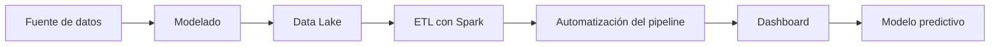

# Proyecto 1 - ITACA

## Descripción y objetivo

El objetivo será construir un **dashboard** (cuadro de mandos) de análisis académico usando **Power BI** a partir de datos *"reales"* en formato **XML** extraídos de la plataforma **ITACA** de la **Consellería de Educación**.

## Arquitectura

Usaremos una arquitectura **Batch**.

Tecnologías usadas:
- MongoDB
- Spark
- Airflow
- Power BI 

## Fuente de datos

Cuatro tablas exportadas de ITACA como ficheros XML:
- Alumnos
- Contenidos
- Calificaciones
- Cursos
- Grupos

| Tabla | Contenido | Campos Clave |
| --- | --- | --- |
| Alumnos | Un registro por alumno y año académico | Anyo, NIA, Curso, PrimSeg, Ciclo, Grado, Familia, Turno, Grupo |
| Contenidos | Módulos que se imparten en cada curso | Anyo, Curso, Modulo, Nombre_Modulo|
| Calificaciones | Nota de cada alumno en cada módulo y evaluación | Anyo, NIA, Curso, Modulo, Nota, Evaluacion |
| Cursos | Catálogo jerarquico de cursos y ciclos formativos | Anyo, Codigo, Nombre,Padre |
| Grupos | Grupos de los módulos que se imparten en el centro | Codigo, nombre, ensenanza, linea, turno, modalidad, aula, capacidad |

| Fuente | URL / Origen | Formato | Frecuencia actualización | Licencia | Última ingesta |
| --- | --- | --- | --- | --- | --- |
| AULES | ITACA | XML | Única | SIN LICENCIA | 22/10/2026 |

>[!NOTE]
La tabla de arriba no es definitivo, se irá actualizando a medida que avance el proyecto.

## Estructura del repositorio

Estas son las carpetas del repositorio:

| Carpeta | Contenido |
| --- | --- |
| dashboard/ | [dashboard] |
| etl | [etl] |
| ingesta | [ingesta] |

## Como desplegar el entorno

Con el **.env.example** que nos descargaremos, lo copiamos al que utiliza el repositorio.
`cp .env.example .env`

Levantamos los contenedores en modo *detached* con:
`docker compose up -d`

Para mirar que contenedores tenemos:
`docker compose ps`

Para parar el contenedor con:
>[!WARNING]
Perderemos los datos que no estén guardados en volumenes persistidos

`docker compose down`

## Bitácora de prácticas

> Cumplimentar al finalizar la práctica

### Bloque 0 - Entorno

- Objetivo: [ ]
- Pasos realizados: [ ]
- Problemas encontrados y solución: [ ]
- Resultado: [capturas, enlaces]

### Bloque 1 - Ingesta batch

- Objetivo: [ ]
- Pasos realizados: [ ]
- Problemas encontrados y solución: [ ]
- Resultado: [ ]

### Bloque 2 - Bases de datos NoSQL

- Objetivo: [ ]
- Pasos realizados: [ ]
- Problemas encontrados y solución: [ ]
- Resultado: [ ]

### Bloque 3 - Data Lake

- Objetivo: [ ]
- Pasos realizados: [ ]
- Problemas encontrados y solución: [ ]
- Resultado: [ ]

### Bloque 4 - Procesamiento con Spark

- Objetivo: [ ]
- Pasos realizados: [ ]
- Problemas encontrados y solución: [ ]
- Resultado: [ ]

<!--
### Bloque 5 - Streaming con Kafka

- Objetivo: [ ]
- Pasos realizados: [ ]
- Problemas encontrados y solución: [ ]
- Resultado: [ ]
-->

<!--
### Bloque 6 - FIWARE e IoT

- Objetivo: [ ]
- Pasos realizados: [ ]
- Problemas encontrados y solución: [ ]
- Resultado: [ ]
-->

### Bloque 7 - Orquestación, calidad y gobierno

- Objetivo: [ ]
- Pasos realizados: [ ]
- Problemas encontrados y solución: [ ]
- Resultado: [ ]

| Nombre | Ubicación | Descripción | Esquema | Frecuencia | Responsable | Sensibilidad |
| --- | --- | --- | --- | --- | --- | --- |
| [tabla] | [ruta / colección] | [] | [] | [] | [] | [baja / media / alta] |

### Bloque 8 - Visualización

- Objetivo: [ ]
- Pasos realizados: [ ]
- Problemas encontrados y solución: [ ]
- Resultado: [ ]

### Bloque 9 - Inteligencia Artificial

- Objetivo: [ ]
- Pasos realizados: [ ]
- Problemas encontrados y solución: [ ]
- Resultado: [tabla de métricas]

<!--
### Bloque 10 - Nube

- Objetivo: [ ]
- Pasos realizados: [ ]
- Problemas encontrados y solución: [ ]
- Resultado: [ ]
-->

### Decisiones técnicas

Las 2–3 decisiones de diseño más importantes, con la alternativa descartada. Te servirán para la defensa (Bloque 11, apartado 3).

| Decisión | Alternativa descartada | Motivo |
| --- | --- | --- |
| [] | [] | [] |

### Incidencias resueltas

| Problema | Causa | Solución |
| --- | --- | --- |
| [] | [] | [] |

## Resultado final

> Capturas del dashboard y del modelo, y enlace al vídeo o a la demo si la hay.